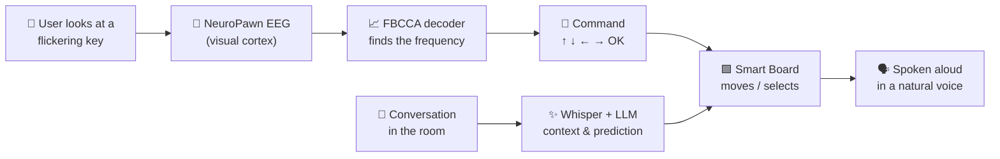
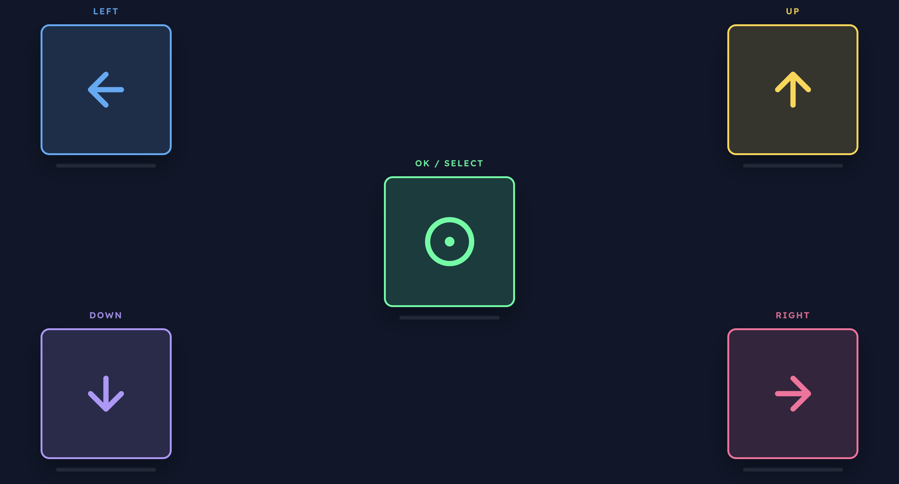
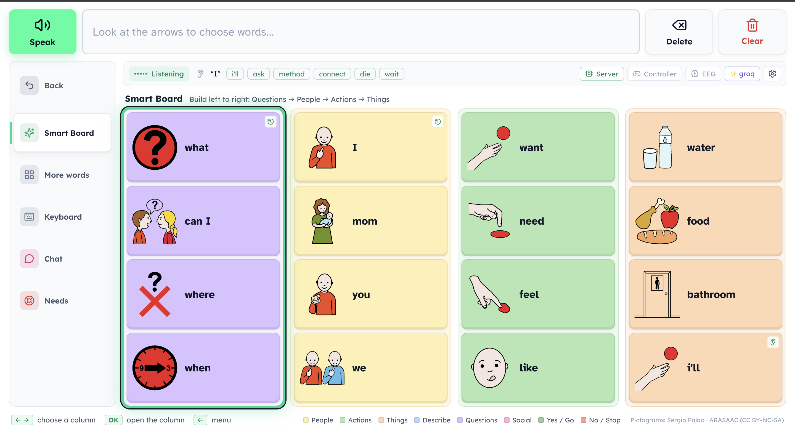
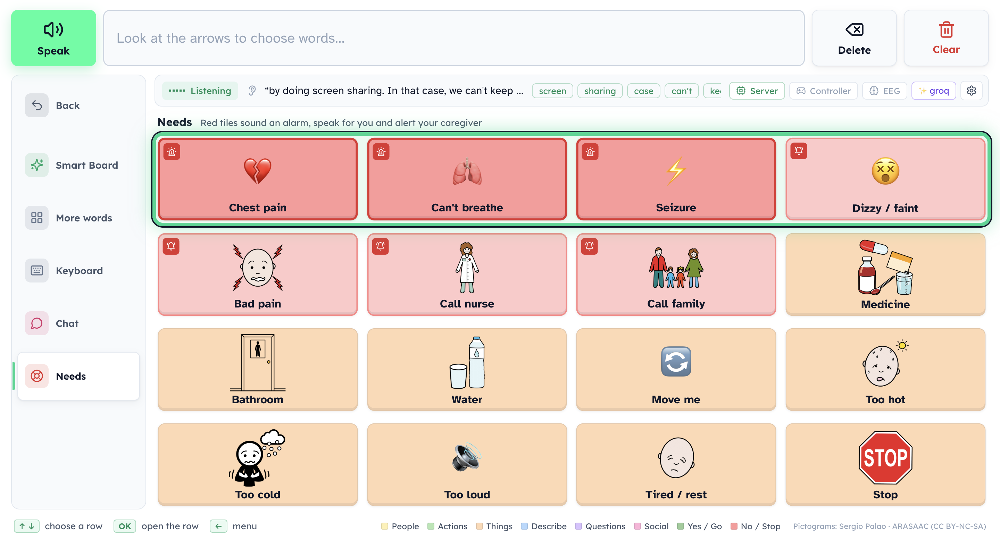
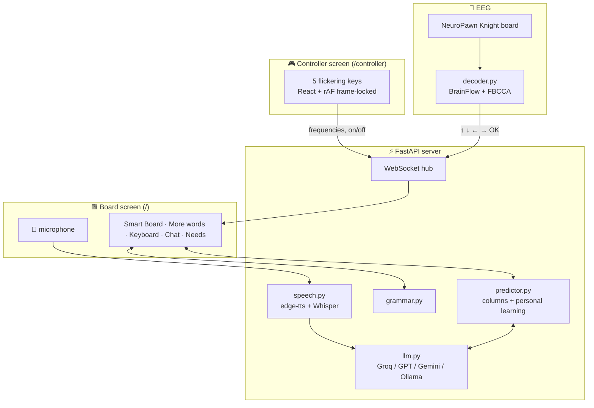

<div align="center">

# 🧠 AdaptiBoard

### Speak with your eyes. Powered by your brain.

**A brain-computer interface that lets people who can't speak or move build sentences, out loud, just by looking.**


*Someone nearby asks "Do you want pizza or pasta?" The board hears it, puts **yes / no** and **pizza / pasta** right where the user is looking, and turns the picked words into the sentence "**I want to eat.**"*

</div>

---

## 💡 The problem

Millions of people live with ALS, locked-in syndrome, cerebral palsy, stroke or spinal-cord injury and **cannot speak or use their hands**. Today's communication boards are often:

- **Slow:** one word can take a minute.
- **Static:** the same grid of words no matter what's happening in the room.
- **Out of reach:** eye trackers and touch screens assume control the user may not have.

The result is that people with plenty to say get left out of the conversation.

## ✨ The idea

AdaptiBoard combines three things into one board that **thinks ahead for the user**:

| 🧠 **Brain control** | 👂 **Context awareness** | 🤖 **AI that learns you** |
|---|---|---|
| Five keys flicker at different rates. The user just *looks* at one, and an EEG headset reads the matching rhythm in their visual cortex (SSVEP). | The board listens to the people nearby and fills itself with the words the user is most likely to need next. | It predicts the next word from the conversation, the time of day and the user's own habits, and fixes grammar before speaking. |

**Five commands (↑ ↓ ← → OK) and no training** are enough to have a real conversation.

---

## 🎬 How it works



1. **Look.** The controller screen shows five big keys, each flickering at its own rate: ← 10 Hz, ↑ 6 Hz, ↓ 8 Hz, → 12 Hz and **OK 15 Hz**.
2. **Decode.** Filter-bank CCA reads the EEG every half second and works out which rhythm the brain is following. It needs **no calibration session**.
3. **Move.** The command moves a gliding highlight on the board, like a TV remote.
4. **Speak.** Every chosen word is spoken in a natural neural voice. **Speak** reads out the whole sentence, grammar-corrected.

---

## 📸 A tour

<table>
<tr>
<td width="50%">

**🎮 The brain controller**<br/>
Four arrows in the corners and **OK / Select** in the middle, as far apart as the screen allows, so the brain locks onto one rhythm at a time.



</td>
<td width="50%">



**🆘 One-look emergencies**<br/>
"Chest pain" sounds a siren, speaks *"Please call nine one one"* and pages the caregiver's phone. It can't be cancelled by accident.



</td>
</tr>
<tr>
<td>


---

## 🚀 Features

### 🧠 Brain-computer interface
- **SSVEP control with five commands.** Every part of the board can be reached with ↑ ↓ ← → OK.
- **Training-free decoding.** Filter-bank CCA works for a new user straight away.
- **Frame-locked flicker** synced to the display's refresh rate, with a refresh-rate check built in.
- **Live feedback bars** under each key show what the decoder is "seeing" in real time.
- **Guards against mistakes:** a confidence threshold, an extra-strict **OK**, and a re-arm rule, so one long stare can never select twice.
- **Optional jaw clench** works as a second OK switch, using a trained classifier.

### ✨ Smart Board
- **Four columns that read like a sentence:** Questions → People → Actions & Feelings → Food & Things.
- **Predicts as you go.** After every pick, all columns re-predict and the highlight jumps to the next column.
- **Hears questions.** When someone asks the user something, *yes / no / I don't know* move to the top automatically.
- **Grammar fixing.** "I was walk" becomes **"I was walking."** and "he want go park" becomes **"He wants to go to the park."**. The AI is only allowed to fix grammar, never change the user's words.

### 👂 Context awareness
- **Always listening:** speech-to-text with Groq Whisper, OpenAI or Chrome. The board's own voice is ignored.
- **LLM context extraction** pulls out the topic, likely replies, and the names, foods and places just mentioned.
- **Tiles never jump** under the highlight. New context waits until the user's next choice.

### 🤖 Learns the user
- Learns **word pairs and triples**, **time-of-day** habits and **favourite sentences**. In testing, after three uses of "I want juice", *juice* moved to the top.
- **Chat** keeps every sentence the user has spoken, most used first.
- A **caregiver profile** (family names, likes, notes) feeds into every prediction.

### 🆘 Safety first
- **Emergency triggers** sound a siren, speak out loud, show a full-screen *Call 911* alert and send the caregiver a **phone push** via ntfy.
- **3-second arming** on alerts, so the same gaze that raised one can't dismiss it.
- **Photosensitivity warning** before any flicker starts, and the flicker stops whenever its tab is hidden.

### ♿ Designed for accessibility
- Colour coding that follows AAC (augmentative and alternative communication) conventions, ARASAAC pictograms on every word, and the **Atkinson Hyperlegible** font.
- **10 neural voices** (US / UK / India / Australia; female, male and child).
- Works **fully offline** with rule-based prediction and grammar when there's no API key.

---

## 🏗️ Architecture



| Layer | Tech |
|---|---|
| **Frontend** | React 18, TypeScript, Vite, Framer Motion (the gliding focus ring), Lucide icons |
| **Backend** | Python, FastAPI, WebSockets, httpx |
| **EEG** | NeuroPawn Knight board, BrainFlow, NumPy / SciPy, filter-bank CCA, scikit-learn |
| **AI** | Groq (Llama 3.3 70B + Whisper), OpenAI, Gemini or local Ollama: pick one |
| **Speech** | Microsoft Edge neural voices (`edge-tts`), Whisper speech-to-text |
| **Symbols** | ARASAAC pictograms |

```
adaptiboard/
├── server/     FastAPI hub, predictor, LLM layer, grammar, speech, Needs, vocabulary
├── web/        React app: "/" = board, "/controller" = flicker controller
├── eeg/        decoder.py (SSVEP → commands), fbcca.py, headset tools
└── images/     screenshots
```

---

## ⚡ Quick start

You need **Python 3.10+**, **Node 18+** and **Chrome**.

```bash
git clone https://github.com/manusha27/AdaptiBoard.git
cd AdaptiBoard
./start.sh                 # Windows: start.bat (installs everything on the first run)
```

Then:
1. Open **http://localhost:8000** and click **Start**.
2. Open **http://localhost:8000/controller** in a second window, then click **Keys only** to drive the board with your mouse.

**Try it without a headset:**
```bash
source .venv/bin/activate
python eeg/decoder.py --server http://localhost:8000 --simulate
# type u / d / l / r / o + Enter to "look" at a key
```

### 🔑 Turn on the AI (free)

Create `server/.env` and add **one** key:
```bash
GROQ_API_KEY=gsk_...        # free at console.groq.com: LLM + speech-to-text
# or GEMINI_API_KEY=...     # free at aistudio.google.com
# or OPENAI_API_KEY=...     # paid
# or OLLAMA_MODEL=llama3.2  # free, runs locally
NTFY_TOPIC=my-secret-topic  # optional: caregiver phone alerts via the ntfy app
```

### 🧠 Connect the EEG headset

```bash
ls /dev/cu.*                                    # find the headset (macOS)
python eeg/decoder.py --server http://localhost:8000 --port /dev/cu.usbserial-XXXX -v
```
- Put electrodes over the back of the head (**O1, Oz, O2, PO3, POz, PO4**).
- Make the controller full screen at 60 Hz and click **Start flicker**.
- Look at a key for a few seconds.

<details>
<summary><b>🖥️ Two-laptop setup</b></summary>

Run the server on the board laptop. `start.sh` prints the controller address (`http://<board-IP>:8000/controller`); open it in Chrome on the second laptop.

Campus Wi-Fi such as eduroam often blocks laptops from connecting to each other. Use a **phone hotspot**, `cloudflared tunnel --url http://localhost:8000`, or Tailscale instead. Keep the board on `localhost` so the microphone works.

</details>

<details>
<summary><b>🎮 Controls cheat sheet</b></summary>

| Highlight is on… | ↑ / ↓ | ← / → | OK |
|---|---|---|---|
| a Smart Board **column** | ↑ top bar | previous / next column | enter the column |
| a **tile** in a column | previous / next tile | other columns | **say it** and jump to the next column |
| a **row** (More words, Chat, Needs, Keyboard) | previous / next row | ← menu | enter the row |
| a **tile / key** in a row | leave the row | previous / next tile | choose it |
| the **menu** | previous / next page | → back to the page | open it |
| the **top bar** | ↓ back to the page | Speak · Use sentence · Delete · Clear | do it |
| an **emergency alert** | – | – | dismiss (after 3 s) |

On a physical keyboard, the arrows + Enter are the five commands, and letters type straight into the Keyboard page.

</details>

<details>
<summary><b>🎛️ Decoder tuning</b></summary>

| Flag | What it does |
|---|---|
| `--window 4` | seconds of EEG per decision (longer = steadier, slower) |
| `--z 3` | evidence needed (higher = fewer mistakes) |
| `--ok-strict 1.3` | extra evidence required for OK |
| `--notch 60` | mains frequency (50 outside the Americas) |
| `--imu` | the headset box says IMU |
| `--clench-model file.joblib` | jaw clench as a second OK |

Frequencies can be changed live in the controller's setup panel, and the decoder follows automatically.

</details>

---

## 👥 Team

Built at **BR41N.IO, Neurotech @ NC State**, for the **NeuroPawn** track.

- **Swetha Manivasagam:** [@SwethaatGH](https://github.com/SwethaatGH)
- [@manusha27](https://github.com/manusha27)
- Aarush Dixit (https://github.com/aarushdixit)
- **Jenna Chonillo**
- **Sina Baghbanijam**
- **Myles Thomas** 


**Everyone deserves a voice in the conversation. 💬**

</div>
